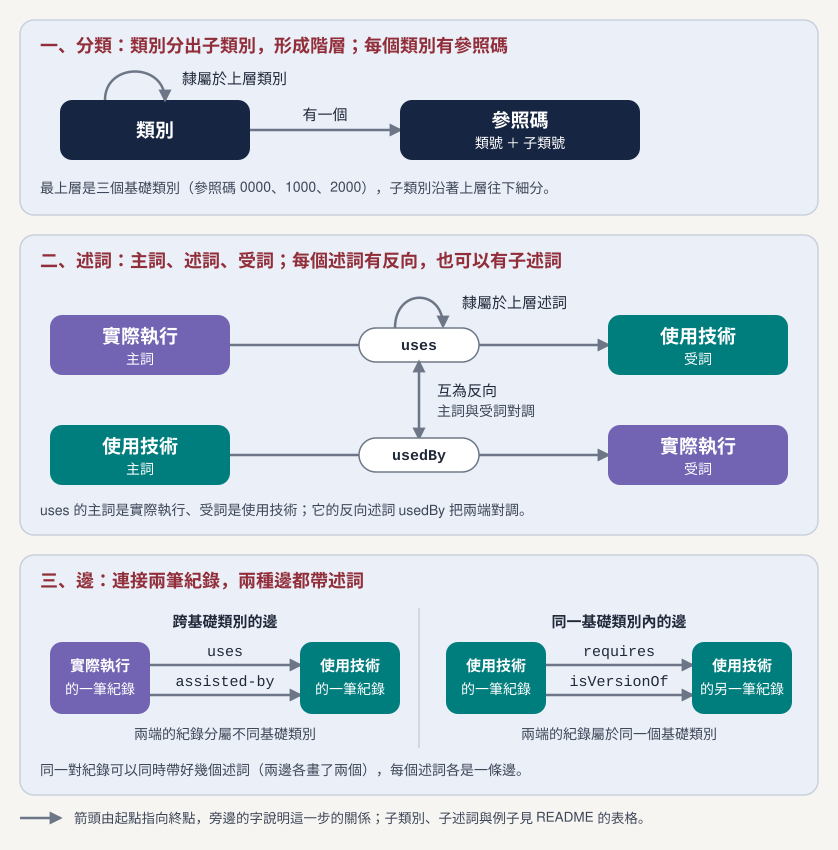
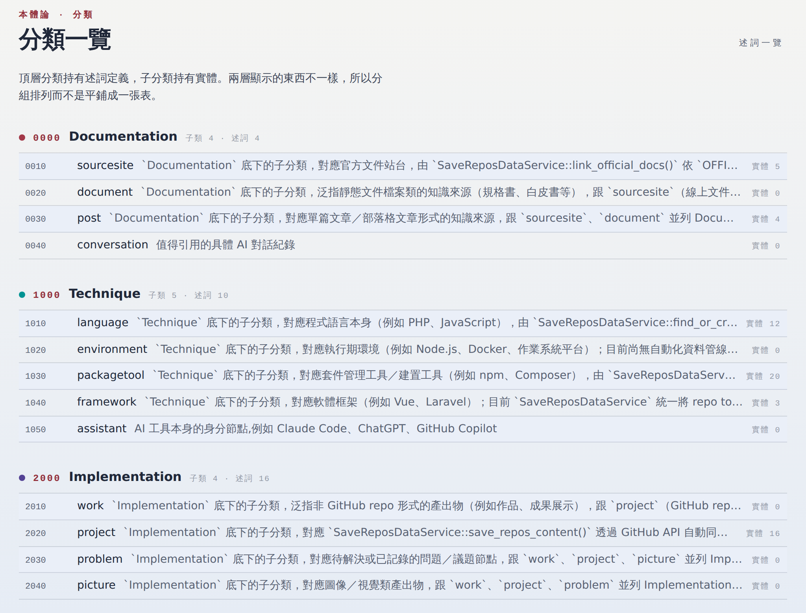

# 網頁開發學習資源資料庫

紀錄並管理自己學做作品及學習時的過程和內容。透過排程獲取git api資訊後加值，希望除了呈現給工程師外，也能讓非工程師瞭解我學習的內容。

## 學習過程概念

借鑑Linked Data三元組的觀念，將做side project或學習特定程式的過程記錄下來。




圖上只畫三個基礎類別，以及類別之間的基礎關聯；每個類別底下的子類、每組關聯底下的子類型，列在下面 Scope、Relation 兩節的表格。

### Scope(主詞/受詞)

判斷紀錄屬於哪個類別，主要包括文件(Documentation)、使用技術(Technique)、實際執行(Implementation)



基礎類別底下的子類（`Scope` 的第二層，每筆紀錄的 `type` 欄位指向其中一個）：

| 子類型 | 屬於哪個基礎類別 | 意思 |
| --- | --- | --- |
| `sourcesite` | Documentation | 官方文件站台，例如 Vue、Laravel 官網 |
| `document` | Documentation | 靜態文件檔，例如規格書、白皮書 |
| `post` | Documentation | 單篇文章、部落格文章 |
| `conversation` | Documentation | 值得引用的 AI 對話紀錄 |
| `repository` | Documentation | 外部的程式碼庫（包含 skill、工具），`url` 存 repo 網址 |
| `language` | Technique | 程式語言，例如 PHP、JavaScript |
| `environment` | Technique | 執行環境，例如 Node.js、Docker |
| `packagetool` | Technique | 套件管理與建置工具，例如 npm、Composer |
| `framework` | Technique | 軟體框架，例如 Vue、Laravel |
| `assistant` | Technique | AI 工具本身，例如 Claude Code、ChatGPT、GitHub Copilot |
| `work` | Implementation | 非 GitHub repo 形式的產出物，例如作品、成果展示 |
| `project` | Implementation | GitHub repo 專案，同步進來的每個公開 repo |
| `problem` | Implementation | 待解決或已記錄的問題、議題 |
| `picture` | Implementation | 圖像、視覺類的產出物 |

### Relation

連接不同類別的關係為何。概念圖上的基礎關聯有五組，每組都是一對方向相反的述詞：

- 文件 ↔ 使用技術：`specs`／`specifiedBy`
- 文件 ↔ 實際執行：`documents`／`documentedBy`
- 實際執行 ↔ 使用技術：`uses`／`usedBy`
- 使用技術 ↔ 使用技術：`requires`／`isRequiredBy`
- 實際執行 ↔ 實際執行：`descendantOf`／`ancestorOf`

同一組之內，還有意思不同的子類型述詞（兩個名字是一對方向相反的述詞，第一個名字與該組基礎關聯的第一個名字方向相同）：

| 子類型 | 屬於哪個基礎關聯 | 意思 |
| --- | --- | --- |
| `about`／`subjectOf` | 文件 ↔ 使用技術（`specs`／`specifiedBy`） | 文章談到某個技術，但不是它的規格或文件 |
| `targets`／`targetedBy` | 文件 ↔ 使用技術（`specs`／`specifiedBy`） | 這份來源（skill、外掛、工具）是寫給這個技術用的，通常是 AI 工具 |
| `aboutProject`／`projectSubjectOf` | 文件 ↔ 實際執行（`documents`／`documentedBy`） | 文章談到某個專案，但不是它的文件 |
| `influences`／`influencedBy` | 文件 ↔ 實際執行（`documents`／`documentedBy`） | 這份來源的規則、做法或概念已經寫進這個實作；還在計畫中的不連 |
| `isBasisFor`／`isBasedOn` | 文件 ↔ 實際執行（`documents`／`documentedBy`） | 外部 repo（當成文件）是這個實作改作的基礎 |
| `assisted-by`／`assists` | 實際執行 ↔ 使用技術（`uses`／`usedBy`） | AI 只提供建議，不是直接產出或執行成品；與 `uses`／`usedBy` 並存，不是取代 |
| `projectAbout`／`subjectOfProject` | 實際執行 ↔ 使用技術（`uses`／`usedBy`） | 專案在講某個技術，但程式裡沒有用到它的證據（只出現在 repo topics） |
| `isVersionOf`／`hasVersion` | 使用技術 ↔ 使用技術（`requires`／`isRequiredBy`） | 某個版本（例如 Vue 3）是版本留空的那一筆（Vue）的一個版本 |
| `accompanies`（對稱） | 實際執行 ↔ 實際執行（`descendantOf`／`ancestorOf`） | 兩個獨立但相伴而生、共同組成同一個產品的 repo，例如前後端拆分 |
| `precedes`／`succeeds` | 實際執行 ↔ 實際執行（`descendantOf`／`ancestorOf`） | 依建立時間前後相接的同性質練習專案 |
| `isBasedOnProject`／`isBasisForProject` | 實際執行 ↔ 實際執行（`descendantOf`／`ancestorOf`） | 建置產物與它的來源專案；跟 `descendantOf` 不同，後者是同一個譜系的前後代（含 fork） |

文件 ↔ 文件目前沒有任何述詞，所以概念圖上 Documentation 沒有指回自己的箭頭。

### 期望目標

希望未來做專案的時候可以獲得更多靈感，或減少解決問題的時間。與專案委託人接洽時，可以更快速地跟對方解釋如何做到，成果如何等。

[前一專案](https://github.com/jerryyehself/Laravel-LearningLibrary)抓取 github 資料的邏輯已經搬過來了，見下面的排程指令。

## 開發

本地環境（含資料庫內容）怎麼從零建起來，見 [`docs/local-dev-setup.md`](docs/local-dev-setup.md)。最短路徑：

```bash
composer install && cp .env.example .env && php artisan key:generate
touch database/database.sqlite          # .env.example 預設 DB_CONNECTION=sqlite
php artisan migrate:fresh --seed        # Scope / Relation 分類架構
php artisan serve                       # http://localhost:8000
php artisan test                        # 全套測試
```

排程指令（從前一專案搬過來的 GitHub 取資邏輯）：

- `php artisan github:sync-repos` — 打 GitHub API，把 repo 資料加值成 `Implementation` / `Technique` 與它們之間的關聯
- `php artisan github:snapshot-repos` — 把當下的 repo 資料存成快照 fixture，讓測試不用打外部 API

正式環境每天跑一次 `github:sync-repos`：部署時一併更新 Cloud Run Job，由 Cloud Scheduler 觸發。

## 前端

[`my-dev-grid-front`](https://github.com/jerryyehself/my-dev-grid-front)（Vue 3 SPA，部署在 Cloudflare，網址 `jerrylib.com`，正式公開前用 Cloudflare Access 鎖住）是這個 API 的公開網站，也是唯一的管理介面：文章、`Scope`（階層分類號）、`Relation`（述詞）都在那邊新增/編輯。

這個 repo 只提供 API，不建置也不提供任何網頁，建置與部署都不需要 Node／npm（只有本機的 `composer run dev` 用 `npx concurrently` 同時開幾個程序）。原本內嵌在 Laravel 裡的 Vue 後台 Triple 已經移除（D-48），以前它的網址（例如 `/`）現在回 404。

## API

讀（`index` / `show`）完全公開，寫（`store` / `update` / `destroy`）收斂到 `auth:sanctum`，實際擋權邏輯在 `app/Policies`。路由定義見 `routes/api.php`。

| 端點 | 說明 |
| --- | --- |
| `GET /api/graph` | 整張圖：三族節點 ＋ 三張 pivot ＋ `entity_relations` 的邊，`relation_id` 已解析成述詞名稱 |
| `GET /api/graph/path` | 起訖點之間的最短路徑（BFS，邊當無向處理）。逆著走的那一跳會回報反向述詞 |
| `GET/POST/PUT/DELETE /api/scopes` | 階層分類號。三族：`0000` Documentation、`1000` Technique、`2000` Implementation。寫入需要登入 |
| `GET/POST/PUT/DELETE /api/relations` | 述詞。15 條全部成對可逆，`reverse_id` 互指；被任何邊引用後大部分欄位鎖定唯讀（僅 `note` 可改）。寫入需要登入 |
| `GET /api/relations/{id}/edges` | 一條述詞底下的邊，分頁 |
| `GET/POST/PUT/DELETE /api/documentations` | 文件／文章。`body` 欄位存 Markdown 原文。寫入需要登入 |
| `GET/POST/PUT/DELETE /api/techniques` | 技術。寫入 API 已經有了（需要登入），但 `my-dev-grid-front` 還沒有管理畫面，實際資料靠 GitHub sync 自動 find-or-create，已知限制見 [`docs/tech-debt.md`](docs/tech-debt.md) |
| `GET/POST/PUT/DELETE /api/implementations` | 實作／專案。同上 |

### 認證

`my-dev-grid-front` 用 Sanctum **API token**，不是 session cookie（D-56）：

- 帳號密碼：`POST /api/auth/login`／`POST /api/auth/logout`，`GET /api/user` 確認登入狀態。
- Google／LINE：`GET /auth/token/{provider}/redirect` → callback（`TokenSocialAuthController`）登入後，帶著短效 token 導回前端的 `/auth/callback`，前端再用它打 `POST /api/auth/session` 換成正式的一組。LINE 只申請 `openid profile`：套件預設會帶 `email`，但頻道沒有申請 email 權限，會回 `INVALID_SCOPE`。
- 重新整理後維持登入：access token 只活 15 分鐘（`SANCTUM_ACCESS_TOKEN_EXPIRATION`），另外發一支 30 天的 refresh token（`SANCTUM_REFRESH_TOKEN_EXPIRATION`，套件 `d076/sanctum-refresh-tokens`），放在 API 網域的 `__Host-mdg_refresh` cookie（HttpOnly、Secure、SameSite=None、Partitioned）。前端開機時打 `POST /api/auth/refresh` 換回登入狀態，每次換發都會換掉 refresh token（單次使用）；用過的 refresh token 被重放會撤銷同一次登入的所有 token（`App\Services\RefreshTokenFamilies`），一次登入最長 90 天（`SANCTUM_REFRESH_TOKEN_MAX_LIFETIME`）。登出不要求有效的 access token，refresh cookie 也能撤銷。refresh／session／logout 只接受 `Origin` 等於 `FRONTEND_URL` 的請求。為什麼 OAuth 回呼不能直接設 cookie，見 `TokenRefreshController` 的類別註解。

跨 origin 的 SPA 要用 cookie 模式，前後端得共用同一個根網域。前端在 `jerrylib.com`，後端目前用 Cloud Run 的 `*.run.app` 網址；要等後端也掛上 `api.jerrylib.com` 這類子網域，才重新評估要不要換成 cookie 模式（目前記成低優先度技術債）。

另外還有一組同源 session cookie 的登入（`SessionAuthController`：`POST /auth/login`、`POST /auth/logout`，社群登入走 `/auth/{provider}/*`），原本給已移除的 Triple 後台用，目前沒有前端在用。兩套認證刻意不共用同一支 controller。

### 文章的內文

`documentations.body` 存的是 **Markdown 原文**，不是渲染後的 HTML——渲染在前端走 AST 產生 Vue 元件，不經過 `v-html`。所以這一欄刻意不受 `TrimStrings` 中介層處理（`bootstrap/app.php`）：Markdown 文件開頭的四個空白縮排是「程式碼區塊」，被 trim 掉等於默默改掉文件的意思。

## 部署

Cloud Run ＋ Cloud SQL Postgres，`--min-instances=0` 可以縮到零。設計與實際設定見 [`docs/deployment-gcp.md`](docs/deployment-gcp.md)、[`docs/infrastructure-concepts.md`](docs/infrastructure-concepts.md)，workflow 在 `.github/workflows/deploy-cloud-run.yml`。

已經部署在正式環境（服務 `my-dev-grid-api`，區域 `asia-east1`）。平常的 PR 合進整合分支 `develop`，不會部署；每週上線時合進 `main` 才部署（流程見 [`docs/release.md`](docs/release.md)）。push 到 `main` 會觸發 workflow，依序做這幾件事：建置並推送映像檔、用 Cloud Run Job 跑 `php artisan migrate --force`、部署新版（先不接流量，對新版的專用網址自動檢查，通過才切流量）、更新每天同步 GitHub 的 Job。同一時間只跑一個部署，後到的排隊（`concurrency`）。

因為 migration 跑完到新版上線之間，舊版程式還在接流量，資料庫結構變更要照 `CLAUDE.md`「資料庫結構變更的順序」分次上線。改名、刪欄位、改型別、加 NOT NULL 的分次步驟，以及 PostgreSQL 鎖、`lock_timeout`、建索引、回滾的細節，見 [`docs/zero-downtime-migrations.md`](docs/zero-downtime-migrations.md)。

## 更新紀錄

見 [`CHANGELOG.md`](CHANGELOG.md)。
